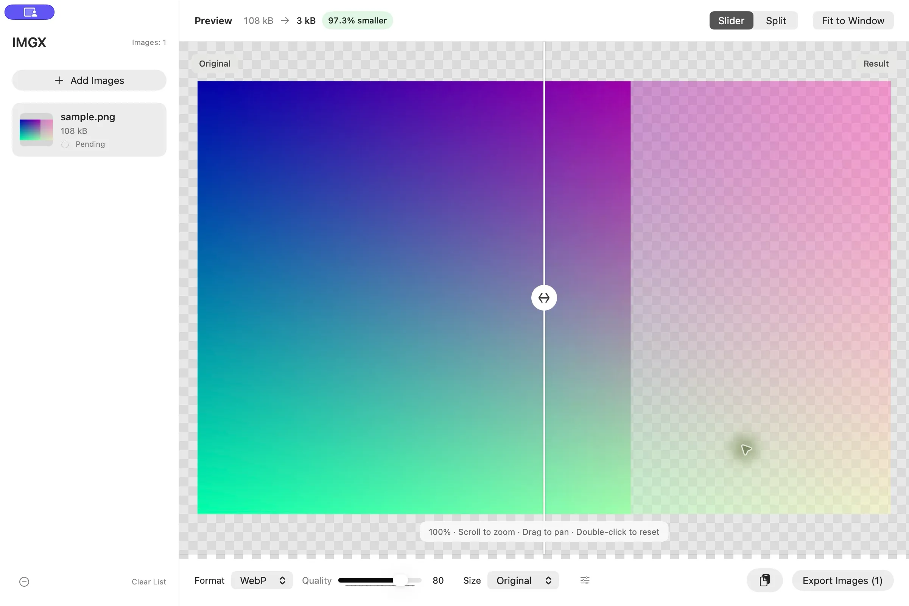

# IMGX

**English** | [简体中文](README_CN.md)

Local image compression, format conversion, and PDF-to-image conversion for Mac.

Drop images, PDFs, or entire folders into IMGX, choose a format and size, compare the result, and export in batches. Your files stay on your Mac, and originals are preserved.

**Apple Silicon · macOS 26+ · Native macOS app**

Available in English, Simplified Chinese, Traditional Chinese, and Japanese. IMGX follows your preferred system language and falls back to English for unsupported languages. Restart IMGX after changing the system or per-app language.

[Download](https://github.com/cndiandian/IMGX/releases/latest) · [Installation](#installation) · [Quick start](#quick-start) · [Report an issue](https://github.com/cndiandian/IMGX/issues)

## Preview



Drag the divider to inspect compression quality, or switch to Split view. File sizes reflect the actual encoded result. This screenshot was exported to WebP using IMGX itself.

## Features

- **Compress and convert:** batch export to WebP, JPEG, or PNG, with adjustable quality and lossless WebP.
- **Compare actual results:** inspect the original and encoded image using Slider or Split view before exporting.
- **Resize:** keep the original size, scale to 50% or 25%, or set custom dimensions while preserving aspect ratio.
- **Process folders:** recursively import images and PDFs and preserve their folder structure on export.
- **Convert PDF pages:** preview each page and export numbered images using the current format and size settings.
- **Use the clipboard:** paste screenshots, copied images, or files copied in Finder; copy the current converted result to another app.
- **Keep originals:** source images and PDFs are never overwritten. Existing output filenames receive a numeric suffix.
- **Find your exports:** click the destination path or Open Folder in the completion notice.

This document describes the current source tree. See the [release notes](https://github.com/cndiandian/IMGX/releases) for features included in a specific download.

## Installation

Requires an **Apple Silicon Mac (M series)** running **macOS 26 or later**. Intel Macs are not supported.

### Download the app

1. Open [GitHub Releases](https://github.com/cndiandian/IMGX/releases/latest).
2. Download the `.dmg` file under Assets.
3. Open it and drag **IMGX** into **Applications**.
4. Launch IMGX from Applications.

### Install with Homebrew

```sh
brew install --cask cndiandian/tap/imgx
```

If Homebrew reports that the cask comes from an untrusted tap, trust it and retry:

```sh
brew trust --cask cndiandian/tap/imgx
```

## Quick start

1. **Add files:** click Choose Images, drop images, PDFs, or folders into the window, or press `⌘V` to paste clipboard images or copied files. You can add multiple items at once.
2. **Choose output settings:** select WebP, JPEG, or PNG and adjust quality and size. Additional options are under More Settings.
3. **Inspect the result:** select an image or PDF page in the sidebar. Use Slider, Split, zoom, and pan to check details.
4. **Export:** click Export Images and choose a destination folder. Click the path or Open Folder in the completion notice to view your files.

Export processes every item in the list. The selected item controls the preview only. Each export batch uses the settings captured when it starts.

To copy just the current result, click the clipboard button beside Export, use Edit → Copy Current Result, or press `⌘C`. This copies the encoded image or selected PDF page with the current quality, size, and transparency settings. Copying is unavailable until the preview is ready. The clipboard contains the selected format plus a PNG-compatible representation; the receiving app chooses which to use. In text fields or selected text, `⌘C` keeps its normal text-copy behavior.

Pasted image data is stored as a local temporary PNG that preserves transparency. IMGX removes its own temporary copies when you remove the item, clear the list, or quit normally. Source files and clipboard contents are preserved. In text fields, `⌘V` pastes text normally.

### Folder exports

Adding a folder preserves that folder and its subfolders:

```text
Input:  Album/Trip/Photo.jpg
Output: Destination/Album/Trip/Photo.webp
```

Individually added images go directly into the destination folder. Same-named root folders from different locations receive distinct numbered names. Adding a file again keeps the hierarchy from its first import.

Folder scanning runs in the background and can be canceled. Export is unavailable while scanning. Hidden items, packages, and symbolic links are skipped. Only directories needed for successful exports are created; unrelated files and empty directories are not copied.

### PDF exports

PDFs appear as individual pages, each with its own preview and removable list entry. Exported images use numbered filenames:

```text
Guide.pdf → Guide-page-001.webp
            Guide-page-002.webp
            …
```

Pages render at **300 DPI on a white background**, respecting crop bounds and rotation. Original size refers to this rendered image. All pages use the current output format and size settings. PDFs imported with a folder preserve its hierarchy too.

## Formats and limits

| Type | Support |
| --- | --- |
| Image input | Static JPG, JPEG, PNG, WebP, and HEIC images |
| Document input | PDF, converted page by page |
| Image output | WebP, JPEG (`.jpg`), PNG |
| Transparency | Preserved in PNG and WebP; flattened onto white for JPEG |
| Output dimensions | Up to 16,383 pixels per edge and 100 million pixels total |

Animation is not preserved. Complete preservation of EXIF, ICC, HDR, or other metadata is not guaranteed; keep your originals if you need this information. The file list and settings do not persist between launches.

Rendered PDF pages are subject to the same dimension and pixel limits. Locked encrypted PDFs, corrupt documents, and documents without pages cannot be imported. A page that fails to preview or export reports an error without preventing other valid items from being processed.

## Updates and FAQ

### How do I update?

Open **IMGX → About IMGX → Check for Updates**. When a newer stable GitHub release is available, IMGX downloads and verifies the DMG, then opens it. Drag the new app into Applications to complete installation. Checks and downloads can be canceled. Downloads are stored in separate directories under `Downloads/IMGX`.

For Homebrew installations:

```sh
brew update
brew upgrade --cask imgx
```

### Are my files uploaded?

No. Images and PDFs are read, converted, and exported locally. GitHub is contacted when you explicitly check for or download updates.

### Can IMGX overwrite my originals?

No. Existing output files get suffixes such as `-1` and `-2`. Removing or clearing list entries does not delete source files from disk.

### Why is the result sometimes larger?

Size depends on the image content, formats, dimensions, and quality. Changing formats or using lossless compression can increase size. Compare the encoded size in the preview before adjusting quality or dimensions.

### Why is there no compression percentage for a PDF page?

A PDF can contain multiple pages, so its document size is not a meaningful baseline for one rendered page. The preview shows that page's output size; the sidebar shows the source PDF's total size.

### What does 100% in the preview mean?

It is the baseline after fitting the image to the window, rather than a one-to-one mapping between image and screen pixels. Scroll or pinch to zoom, drag to pan, and double-click or click Fit to Window to reset.

## Keyboard shortcuts

| Action | Shortcut |
| --- | --- |
| Add images, PDFs, or folders | `⌘O` |
| Paste images or copied files | `⌘V` |
| Copy the current converted result | `⌘C` (text editing retains normal copy behavior) |
| Export all list items | `⌘E` |
| Toggle Slider / Split | `\` (outside text editing) |
| Fit to Window | `⌘0` |
| Select the previous / next file | `↑` / `↓` (main window, outside text editing or dialogs) |
| Remove the selected item | `Delete` (outside text editing) |

With the canvas focused, left/right arrows pan horizontally, up/down arrows select files, `+` / `-` zoom, `0` resets, and `[` / `]` move the comparison divider.

## Feedback and contributions

Found a bug or have an idea? [Open an issue](https://github.com/cndiandian/IMGX/issues) with your macOS version, IMGX version, steps to reproduce, and relevant screenshots. Share sample files only if they can be made public.

Pull requests are welcome. Consider discussing substantial changes in an issue first. Before submitting, run the checks below and describe your change and validation results.

## Development and verification

The following sections are for building, modifying, or releasing IMGX. For everyday use, install the app above.

### Build locally

Requires Apple Silicon, macOS 26+, full Xcode 26+, and Swift 6.2+. IMGX uses SwiftUI and AppKit. Build with Swift Package Manager or open `Package.swift` in Xcode.

```sh
git clone https://github.com/cndiandian/IMGX.git
cd IMGX
swift build
bash Scripts/check.sh
bash Scripts/build-app.sh
open dist/IMGX.app
```

`build-app.sh` defaults to a Release build with an ad hoc signature for local testing. This is not Developer ID distribution signing or notarization. The app is written to `dist/IMGX.app`.

WebP 1.6.0 and libsharpyuv headers and static libraries are bundled for arm64. Building and running do not depend on Homebrew dynamic libraries. Third-party licenses are copied into the app's Resources directory.

<details>
<summary>Debug options, tests, and verification scope</summary>

```sh
bash Scripts/build-app.sh debug
bash Scripts/check.sh
```

These environment variables are available only in Debug builds. They do not change system settings:

| Variable | Purpose |
| --- | --- |
| `IMGX_DEV_APPEARANCE=dark` / `light` | Set the app's appearance |
| `IMGX_DEV_SMALL_WINDOW=1` | Check the small-window layout |
| `IMGX_DEV_INPUTS` | Import newline-separated file paths at launch |

The unified check runs 46 Swift tests and 25 offline script tests covering encoding, alpha, EXIF orientation, sizing, import deduplication, folder structure, PDF pages and rotation, cancellation races, preview/export consistency, file protection, canvas accessibility, and update verification. Script tests mock signing and Apple tools without accessing credentials or uploading the app.

Script tests can also run independently:

```sh
python3 Scripts/test-build-app.py
python3 Scripts/test-homebrew-tap.py
python3 Scripts/test-publish-release.py
```

Main-branch pushes and pull requests targeting main run the unified checks without signing or notarization secrets. Tag releases use the same checks.

Developer ID signing, Apple notarization for the app and DMG, stapling, and Gatekeeper assessment have been verified locally. Installation on another Mac has not been verified. Passing automation does not imply complete validation of all windows, VoiceOver, complex PDFs, or large-file stress cases.

</details>

### Localization

Localization follows the PodLilt approach: type-safe keys and separate Swift dictionaries compiled into the app, under `Sources/IMGX/Localization`. No language-pack downloads are needed.

| File | Role |
| --- | --- |
| `AppLanguage.swift` | Supported languages and system-language matching |
| `L10nKey.swift` | All text keys |
| `L10n.swift` | Dictionary registry, argument replacement, English fallback |
| `English.swift` | Base English dictionary |
| `SimplifiedChinese.swift` | Simplified Chinese |
| `TraditionalChinese.swift` | Traditional Chinese |
| `Japanese.swift` | Japanese |

Use `L10n.text(.chooseImages)` for UI and status text. Parameterized strings use calls such as `L10n.text(.exportCount, String(count))` and `%@` placeholders. Avoid assembling translated sentence fragments or using display text for identifiers, extensions, or focus checks.

For new strings, add a key to `L10nKey` and update all four dictionaries. To add a language, create its dictionary, extend `AppLanguage` and its matching rules, register it in `L10n.translations`, and update `CFBundleLocalizations` in `Scripts/Info.plist`. English is the development language and fallback for missing entries.

Run `bash Scripts/check.sh` to verify dictionary completeness, placeholder counts, region/script matching, unsupported-language fallback, and safe replacement when filenames contain format characters. Examples: `zh-Hans` selects Simplified Chinese; `zh-Hant`, `zh-TW`, `zh-HK`, and `zh-MO` select Traditional Chinese; `ja` selects Japanese; unsupported preferences such as `fr` fall back to English.

## Signing, notarization, and releases

<details>
<summary>Local Developer ID signing, Apple notarization, and packaging</summary>

Distribution requires Apple Developer Program membership, full Xcode, and a **Developer ID Application** certificate with its private key in Keychain. Run commands from the project root.

**Option 1: App Store Connect API key**

For initial setup, copy the example. Keep an existing configuration if you already have one:

```sh
cp Scripts/release.env.example .release.env
```

Edit `.release.env` with the certificate name or SHA-1, `.p8` path, Key ID, and Issuer ID for a team key. Omit Issuer ID for an individual key. Adjust `APP_VERSION` and `BUILD_NUMBER` as needed; defaults are `0.1.0` and `1`.

Build and sign without submitting for notarization:

```sh
source .release.env
bash Scripts/build-app.sh release --sign "$CODE_SIGN_IDENTITY"
codesign --verify --deep --strict --verbose=2 dist/IMGX.app
```

Create a signed, notarized app, ZIP, and DMG:

```sh
source .release.env
bash Scripts/release.sh
```

The script builds, signs, submits to Apple, staples, and validates tickets. The app and DMG are notarized separately. It does not create a GitHub release or update Homebrew.

**Option 2: Keychain notarization credentials**

```sh
security find-identity -v -p codesigning
xcrun notarytool store-credentials IMGX --apple-id 'YOUR_APPLE_ID' --team-id 'YOUR_TEAM_ID'
```

The second command prompts for an app-specific password, not your Apple ID login password. API keys can also be stored in Keychain; see `xcrun notarytool store-credentials --help`.

```sh
bash Scripts/build-app.sh release \
  --sign 'Developer ID Application: YOUR NAME (TEAMID)' \
  --notarize --profile IMGX --dmg
```

`--sign` accepts a certificate name or SHA-1. Defaults can come from `IMGX_SIGN_IDENTITY` / `CODE_SIGN_IDENTITY`; `IMGX_NOTARY_PROFILE` supplies the Keychain profile. API key and Keychain authentication cannot be configured together. Use option 2 in a terminal without API-key environment variables loaded.

**Artifacts and troubleshooting**

The app is written to `dist/IMGX.app`. Each notarization run stores artifacts and logs under `dist/notarization.XXXXXX/`:

| File | Contents |
| --- | --- |
| `IMGX-vVERSION.zip`, `.zip.sha256` | Verified app archive and checksum |
| `IMGX-vVERSION.dmg`, `.dmg.sha256` | Disk image and checksum, generated by `--dmg` or `release.sh` |
| `app-result.json`, `app-log.json` | App notarization result and diagnostics |
| `dmg-result.json`, `dmg-log.json` | DMG notarization result and diagnostics |

Distribute only artifacts with Accepted notarization and successful ticket, signature, and Gatekeeper checks. `IMGX-upload.zip` is an intermediate upload archive.

The default notarization wait is 30 minutes; adjust with `--timeout 60m`. Temporary stapling failures retry up to four times. A timeout does not cancel Apple's processing. Keep the submission ID and query it with the same credentials:

```sh
xcrun notarytool info 'SUBMISSION_ID' --keychain-profile IMGX
xcrun notarytool wait 'SUBMISSION_ID' --keychain-profile IMGX --timeout 60m
xcrun notarytool log 'SUBMISSION_ID' --keychain-profile IMGX 'log.json'
```

For API-key authentication, use `--key`, `--key-id`, and `--issuer` when required for team keys. Do not distribute unverified intermediate artifacts.

For manual recovery, staple and verify only the unchanged app from the same build before recreating archives, or rerun the full release process:

```sh
xcrun stapler staple dist/IMGX.app
xcrun stapler validate dist/IMGX.app
spctl --assess --type execute --verbose=2 dist/IMGX.app
```

`.release.env`, `.p8`, and `.p12` are Git-ignored. Keep passwords and private keys out of the repository. See Apple's [custom notarization workflow documentation](https://developer.apple.com/documentation/security/customizing-the-notarization-workflow).

</details>

<details>
<summary>GitHub Actions releases and Homebrew synchronization</summary>

The release workflow is `.github/workflows/release.yml`. Pushing a tag in `vMAJOR.MINOR.PATCH` format runs tests, builds, signs, notarizes, and publishes a GitHub release with ZIP, DMG, and SHA-256 files. Branch pushes and local-only tags do not publish releases. Prerelease suffixes such as `-beta` are not accepted.

**Signing and notarization secrets**

Add these five entries in [Actions Secrets](https://github.com/cndiandian/IMGX/settings/secrets/actions):

| Secret | Value |
| --- | --- |
| `APPLE_CERTIFICATE_P12_BASE64` | Base64 of the Developer ID Application P12, including its private key |
| `APPLE_CERTIFICATE_PASSWORD` | P12 export password |
| `APP_STORE_CONNECT_API_KEY_BASE64` | Base64 of the App Store Connect `.p8` file |
| `APP_STORE_CONNECT_API_KEY_ID` | Matching Key ID |
| `APP_STORE_CONNECT_API_ISSUER_ID` | Issuer ID for the team key |

In Keychain Access → My Certificates, export the Developer ID Application certificate and private key as a password-protected `.p12`. A `.cer` alone cannot sign apps. Existing GitHub Secret values cannot be read back; retain your original files and configuration.

Copy Base64 to the clipboard, then paste into the matching secret:

```sh
base64 -i '/path/DeveloperID.p12' | tr -d '\n' | pbcopy
base64 -i '/path/AuthKey_KEYID.p8' | tr -d '\n' | pbcopy
```

Use Secrets for passwords and private keys, never YAML, Actions Variables, or issues. The runner uses a temporary Keychain and cleans up signing material on completion or failure. The build job has read access; only the separate publishing job gets repository content write access.

**Homebrew synchronization**

After publication, a separate job downloads the released DMG, verifies SHA-256, and updates `Casks/imgx.rb` on the default branch of `cndiandian/homebrew-tap`. Add a sixth secret: `HOMEBREW_TAP_TOKEN`.

1. Create a [fine-grained token](https://github.com/settings/personal-access-tokens/new) with the appropriate resource owner and expiration.
2. Under Repository access, choose **Only select repositories → homebrew-tap**.
3. Grant repository **Contents: Read and write**, keeping Metadata at its default read access.
4. Store the token in the IMGX repository's `HOMEBREW_TAP_TOKEN` secret.

The workflow's `GITHUB_TOKEN` cannot write to a separate tap repository. Forks must update repository references, tap settings, and permissions in the workflow and synchronization script.

**Publish a version**

These are examples for maintainers to run manually after checking the commit, version, and secrets. Replace the example with a new, unpublished version:

```sh
git push origin main
git tag -a v0.2.0 -m 'Release IMGX 0.2.0'
git push origin v0.2.0
```

The app version comes from the tag; the build number uses the Actions run number. Do not delete or force-move published tags.

**Check results and recover failures**

Inspect build, notarization, publication, and tap results in [Actions](https://github.com/cndiandian/IMGX/actions). Prefer **Re-run failed jobs**. Notarization logs and distribution artifacts are retained for 14 days by default.

The publishing job creates or resumes a draft, uploads and verifies four assets, then makes it public. Interrupted drafts can resume. If an existing release has identical artifacts, publication is skipped; mismatched artifacts stop the job without replacing public assets. Avoid rebuilding and re-signing all jobs unnecessarily, which can change artifacts.

Unchanged Homebrew content produces no new commit. If the tap version is newer than the tag, synchronization is skipped to prevent downgrades. Content-SHA conflicts retry after rereading the version. A tap-only failure does not invalidate the GitHub release; fix the token and rerun that job.

Preview the generated cask offline without writing to GitHub:

```sh
TAP_DRY_RUN=1 python3 Scripts/update-homebrew-tap.py 0.2.0 /path/IMGX-v0.2.0.dmg
```

</details>

## License and acknowledgments

IMGX is released under the [MIT License](LICENSE). Retain its copyright and permission notice when using, modifying, or distributing it.

Thanks to [libwebp](https://chromium.googlesource.com/webm/libwebp/) for WebP encoding and decoding. Bundled WebP and libsharpyuv remain subject to their applicable third-party licenses; see [Vendor/WebP/LICENSE](Vendor/WebP/LICENSE) and [AUTHORS](Vendor/WebP/AUTHORS).
