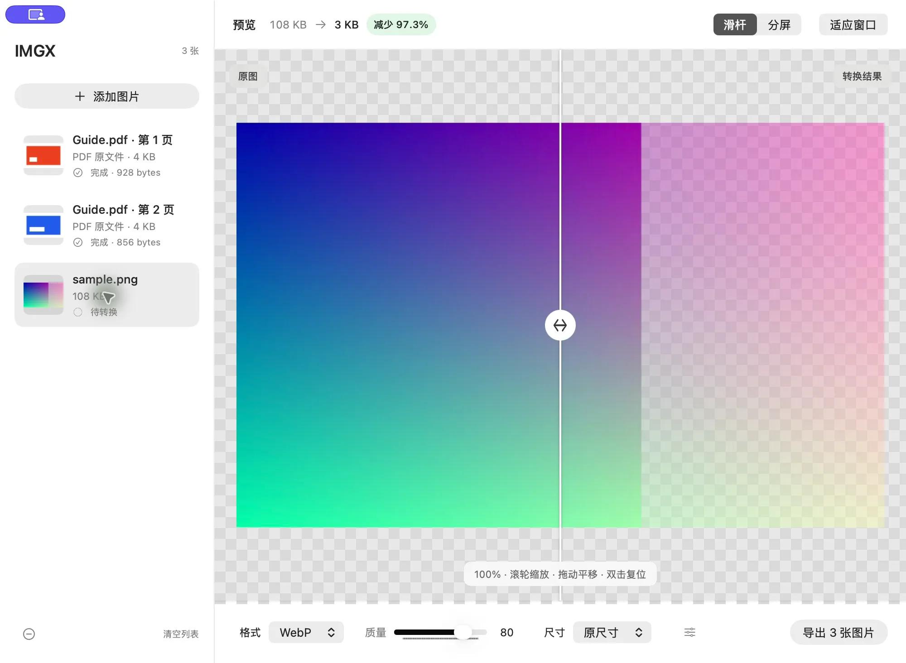

# IMGX

为 Mac 打造的本地图片压缩、格式转换与 PDF 转图片工具。

把图片、PDF 或整个文件夹拖进窗口，调整格式和尺寸，对比画质后批量导出。文件处理在本机完成，保留源文件。

**Apple Silicon · macOS 26+ · 原生 macOS 应用**

支持 English、简体中文、繁體中文和日本語，启动时自动跟随系统首选语言；不支持的语言使用英语。更改系统或应用语言后，重新启动 IMGX 生效。

[下载最新版](https://github.com/cndiandian/IMGX/releases/latest) · [安装说明](#下载与安装) · [快速上手](#快速上手) · [反馈问题](https://github.com/cndiandian/IMGX/issues)

## 界面预览



滑动分隔线检查压缩前后的细节，也可以切换为分屏对比，同时查看实际编码后的文件大小。

## 主要功能

- **图片压缩与转换**：批量输出 WebP、JPEG、PNG，支持质量调整和 WebP 无损模式。
- **真实效果预览**：通过滑杆或分屏对比原图与编码结果，在导出前确认画质和体积。
- **调整图片尺寸**：使用原尺寸、50%、25% 或自定义尺寸，保持图片比例。
- **整文件夹处理**：递归导入图片和 PDF，导出时保留来源文件夹及子目录结构。
- **PDF 按页导出**：每页独立预览，按页码生成图片，沿用当前格式和尺寸设置。
- **保留源文件**：不覆盖原图或 PDF，遇到已有输出文件自动添加编号。
- **快速找到结果**：导出完成后，点击保存路径或“打开目录”即可在 Finder 中查看。

功能说明对应当前仓库代码；下载版本所包含的功能请以 [Release 说明](https://github.com/cndiandian/IMGX/releases) 为准。

## 下载与安装

需要 **搭载 Apple 芯片的 Mac（M 系列）** 和 **macOS 26 或更高版本**。当前不提供 Intel 版本。

### 下载安装包

1. 前往 [GitHub Releases](https://github.com/cndiandian/IMGX/releases/latest)。
2. 在 Assets 中下载以 `.dmg` 结尾的安装包。
3. 打开 DMG，将 **IMGX** 拖入 **Applications（应用程序）**。
4. 从“应用程序”中打开 IMGX。

### 通过 Homebrew 安装

已安装 Homebrew 的用户，也可以在终端执行：

```sh
brew install --cask cndiandian/tap/imgx
```

如果 Homebrew 提示该 Cask 来自未信任的 tap，执行以下命令后重试：

```sh
brew trust --cask cndiandian/tap/imgx
```

## 快速上手

1. **添加文件**：点击“选择图片”，或将图片、PDF、文件夹拖入窗口；可以一次添加多个。
2. **调整输出**：选择 WebP、JPEG 或 PNG，按需要调整质量、尺寸；更多选项在“更多设置”中。
3. **检查画质**：在左侧选择图片或 PDF 页面，使用滑杆、分屏、缩放和平移查看细节。
4. **导出结果**：点击“导出 N 张图片”，选择保存目录。完成后点击提示中的目录地址或“打开目录”查看结果。

导出会处理列表中的全部项目；当前选中项仅决定预览内容。开始导出后，本批次使用当时的参数设置。

### 导出文件夹

直接添加文件夹时，会保留它本身及内部层级。例如：

```text
导入：相册/旅行/照片.jpg
导出：所选目录/相册/旅行/照片.webp
```

单独添加的图片放在所选目录的根目录。不同位置的同名根文件夹自动编号区分；同一图片重复添加时，保留首次导入时的层级。

文件夹读取在后台进行，可点击“取消”；读取期间暂不可导出。隐藏项、软件包和符号链接会跳过，只创建成功导出图片所需的目录，不复制其他文件或空目录。

### 导出 PDF

PDF 导入后按页显示，每页都可以独立预览或从列表移除。导出文件按页码命名：

```text
说明.pdf → 说明-page-001.webp
           说明-page-002.webp
           …
```

默认以 **144 DPI、白色背景**渲染，遵循页面裁切区域和旋转方向；尺寸选项中的“原尺寸”对应此渲染结果。更换输出格式或尺寸后，每页使用同一组设置。随文件夹添加的 PDF 同样保留来源目录层级。

## 支持的格式与限制

| 类型 | 支持内容 |
| --- | --- |
| 图片输入 | JPG、JPEG、PNG、WebP、HEIC 静态图片 |
| 文档输入 | PDF，按页转换为图片 |
| 图片输出 | WebP、JPEG（`.jpg`）、PNG |
| 透明背景 | PNG、WebP 保留透明；JPEG 将透明区域铺为白色 |
| 尺寸上限 | 输出每边不超过 16,383 像素，总像素不超过 1 亿 |

目前不支持保留动态图像，不承诺完整保留 EXIF、ICC、HDR 等信息。需要保留这些信息时，请保管好源文件。列表和设置不会跨应用启动保存。

PDF 渲染后的页面也受尺寸和像素上限约束。未解锁的加密 PDF、损坏或没有页面的文档无法导入；单页预览或导出失败会提示原因，不影响其他可处理项目。

## 更新与常见问题

### 如何更新？

在菜单栏打开 **IMGX → 关于 IMGX → 检测更新**。检测到 GitHub 上新的正式版本后，应用会下载并校验 DMG，再打开安装镜像；将新版本拖入“应用程序”完成更新。下载和检测过程中可取消，安装包保存在“下载/IMGX”的独立目录中。

使用 Homebrew 安装的用户可以执行：

```sh
brew update
brew upgrade --cask imgx
```

### 图片会被上传吗？

不会。图片与 PDF 在本机读取、转换和导出。主动检测更新及下载新版本时会访问 GitHub。

### 会覆盖原文件吗？

不会。已有同名文件时自动添加 `-1`、`-2` 等编号。从列表移除或清空列表，也不会删除磁盘上的源文件。

### 为什么文件不一定更小？

文件大小取决于图片内容、输入输出格式、尺寸和质量。转换格式或使用无损模式可能使文件变大；可以先比较预览中的编码大小，再决定是否降低质量或缩小尺寸。

### 为什么 PDF 没有显示压缩百分比？

一份 PDF 可以包含多页，文档大小不能直接作为单页图片的比较基准。PDF 预览展示当前页的输出大小，侧栏标记整份 PDF 的原文件大小。

### 预览中的 100% 是什么意思？

它表示“适应窗口”后的基准比例，并非一个屏幕像素对应一个图片像素。可以滚轮或捏合缩放、拖动平移，双击画布或点击“适应窗口”复位。

## 快捷键

| 操作 | 快捷键 |
| --- | --- |
| 添加图片、PDF 或文件夹 | `⌘O` |
| 导出列表全部项目 | `⌘Return` |
| 适应窗口 | `⌘0` |
| 在侧栏切换选中项 | `↑` / `↓` |
| 从列表移除选中项 | `Delete`（非文字编辑状态） |

画布获得键盘焦点后，可用方向键平移，`+` / `-` 缩放，`0` 复位，`[` / `]` 调整对比滑杆。

## 反馈与贡献

遇到问题或有功能建议，欢迎提交 [Issue](https://github.com/cndiandian/IMGX/issues)。反馈时请附上 macOS 版本、IMGX 版本、复现步骤及相关截图；如需提供样本文件，请使用可公开分享的内容。

欢迎通过 Pull Request 参与改进。修改代码前可以先通过 Issue 讨论方案；提交前请运行下方的统一检查，并说明修改内容及验证结果。

## 开发与验证

以下内容面向希望自行构建、修改或发布 IMGX 的开发者。日常使用直接下载安装包即可。

### 本地构建

需要 Apple Silicon Mac、macOS 26+、完整 Xcode 26+ 与 Swift 6.2+。项目使用 SwiftUI 与 AppKit，支持通过 Swift Package Manager 构建，也可用 Xcode 打开 `Package.swift`。

```sh
git clone https://github.com/cndiandian/IMGX.git
cd IMGX
swift build
bash Scripts/check.sh
bash Scripts/build-app.sh
open dist/IMGX.app
```

`build-app.sh` 默认生成 Release 应用并使用本地临时签名，供本机开发验证；这不等于完成了正式分发签名和公证。应用位于 `dist/IMGX.app`。

WebP 1.6.0 和 libsharpyuv 的静态库及头文件已随仓库提供，仅含 arm64 架构。构建及运行不依赖 Homebrew 动态库；第三方许可会一并复制到应用 Resources。

<details>
<summary>调试选项、测试与验收范围</summary>

```sh
bash Scripts/build-app.sh debug
bash Scripts/check.sh
```

仅 Debug 构建支持以下环境变量，Release 不启用这些辅助入口，也不会因此改变系统设置：

| 变量 | 用途 |
| --- | --- |
| `IMGX_DEV_APPEARANCE=dark` / `light` | 指定应用内外观 |
| `IMGX_DEV_SMALL_WINDOW=1` | 检查小窗口布局 |
| `IMGX_DEV_INPUTS` | 以换行分隔的文件路径，启动时导入 |

统一检查包含 33 项 Swift 测试及 25 项离线脚本测试，覆盖编码、透明通道、EXIF 方向、尺寸规则、导入去重、文件夹层级、PDF 分页与旋转、取消竞态、预览与导出一致性、文件保护、无障碍画布操作及更新校验。脚本测试模拟签名和 Apple 工具，不读取真实凭据或上传应用。

也可以单独执行脚本测试：

```sh
python3 Scripts/test-build-app.py
python3 Scripts/test-homebrew-tap.py
python3 Scripts/test-publish-release.py
```

主分支推送及面向 main 的 PR 自动运行统一检查，不加载签名或公证 Secrets；tag 发布复用相同检查入口。

本机已完成 Developer ID 签名、应用与 DMG 的 Apple 公证、票据装订和 Gatekeeper 验证；未在另一台 Mac 上完成安装验收。自动化通过不代表所有窗口、VoiceOver、复杂 PDF 和大文件压力场景均已验证。

</details>

### 多语言开发

多语言实现参考 PodLilt，使用类型安全的文案键和独立 Swift 词典，位于 `Sources/IMGX/Localization`，随应用一起编译，无需额外下载语言包：

| 文件 | 职责 |
| --- | --- |
| `AppLanguage.swift` | 支持的语言及系统语言匹配规则 |
| `L10nKey.swift` | 全部文案键 |
| `L10n.swift` | 词典注册、参数替换及缺失翻译时的英语回退 |
| `English.swift` | 英语基础词典 |
| `SimplifiedChinese.swift` | 简体中文 |
| `TraditionalChinese.swift` | 繁體中文 |
| `Japanese.swift` | 日本語 |

界面和业务提示统一调用 `L10n.text(.chooseImages)`；参数化文案如 `L10n.text(.exportCount, String(count))`，词典中以 `%@` 表示参数。不要拼接带语序的翻译片段，也不要将显示文案用于标识、文件扩展名或焦点判断。

增加文案时，在 `L10nKey` 声明新键，并补齐四份词典。增加语言时，新增独立词典，在 `AppLanguage` 增加语言及匹配规则，在 `L10n.translations` 注册，并更新 `Scripts/Info.plist` 的 `CFBundleLocalizations`。英语作为默认开发语言，缺少词条时回退到英语。

运行 `bash Scripts/check.sh` 检查全部语言的键完整性、参数占位符数量、地区及文字系统匹配、不支持语言回退和文件名中格式字符的安全替换。当前按系统首选语言匹配；例如 `zh-Hans` 使用简体，`zh-Hant` / `zh-TW` / `zh-HK` / `zh-MO` 使用繁体，`ja` 使用日语，`fr` 等不支持语言使用英语。

## 签名、公证与自动发布

<details>
<summary>本地 Developer ID 签名、Apple 公证与安装包生成</summary>

正式分发需要 Apple Developer Program 账户、完整 Xcode，以及钥匙串内带私钥的 **Developer ID Application** 证书。以下命令在项目根目录执行。

**方式一：使用 App Store Connect API Key**

首次配置时复制示例文件，已有配置请直接使用：

```sh
cp Scripts/release.env.example .release.env
```

编辑 `.release.env`，填写证书名称或 SHA-1、`.p8` 文件路径、Key ID 和团队密钥的 Issuer ID。个人 API Key 不设置 Issuer ID。按需调整 `APP_VERSION` 与 `BUILD_NUMBER`（脚本默认 `0.1.0` / `1`）。

仅编译并正式签名，不上传公证：

```sh
source .release.env
bash Scripts/build-app.sh release --sign "$CODE_SIGN_IDENTITY"
codesign --verify --deep --strict --verbose=2 dist/IMGX.app
```

生成正式签名且经过公证的应用、ZIP 和 DMG：

```sh
source .release.env
bash Scripts/release.sh
```

脚本依次编译、签名、上传 Apple 公证、装订并验证票据，对应用和 DMG 分别执行公证。它不会自动创建 GitHub Release 或更新 Homebrew。

**方式二：使用钥匙串公证凭据**

```sh
security find-identity -v -p codesigning
xcrun notarytool store-credentials IMGX --apple-id '你的 Apple ID' --team-id '你的 Team ID'
```

第二条命令交互式提示输入 App 专用密码；不要填写 Apple ID 登录密码。也可用 API Key 保存钥匙串凭据，参数见 `xcrun notarytool store-credentials --help`。

```sh
bash Scripts/build-app.sh release \
  --sign 'Developer ID Application: 你的姓名 (TEAMID)' \
  --notarize --profile IMGX --dmg
```

`--sign` 支持证书名称或 SHA-1；默认值可由 `IMGX_SIGN_IDENTITY` / `CODE_SIGN_IDENTITY` 提供，钥匙串凭据名称可由 `IMGX_NOTARY_PROFILE` 提供。API Key 与钥匙串凭据两种认证方式不可同时配置；使用方式二时，应在未加载 API Key 环境变量的终端中执行。

**产物与故障排查**

应用输出至 `dist/IMGX.app`。每次公证在 `dist/notarization.XXXXXX/` 下保存产物和日志：

| 文件 | 说明 |
| --- | --- |
| `IMGX-v版本号.zip`、`.zip.sha256` | 经验证的应用压缩包及校验文件 |
| `IMGX-v版本号.dmg`、`.dmg.sha256` | 使用 `--dmg` 或 `release.sh` 生成的安装镜像及校验文件 |
| `app-result.json`、`app-log.json` | 应用公证结果与诊断日志 |
| `dmg-result.json`、`dmg-log.json` | DMG 公证结果与诊断日志 |

只有公证为 `Accepted`、票据及签名、Gatekeeper 检查通过后，才将对应产物视为可分发文件。`IMGX-upload.zip` 是上传中间文件。

默认每次等待公证 30 分钟，可用 `--timeout 60m` 调整。票据服务临时失败时最多尝试 4 次。超时不代表 Apple 已取消处理；保留提交 ID，使用相同凭据查询：

```sh
xcrun notarytool info '提交 ID' --keychain-profile IMGX
xcrun notarytool wait '提交 ID' --keychain-profile IMGX --timeout 60m
xcrun notarytool log '提交 ID' --keychain-profile IMGX '日志文件.json'
```

API Key 方式改用 `--key`、`--key-id` 和团队密钥所需的 `--issuer` 参数。不要将未通过验证的中间产物当作最终安装包。

如需手动恢复，应仅对同一次构建且未被修改的应用装订和验证，再重新生成压缩包；也可重新执行完整发布流程：

```sh
xcrun stapler staple dist/IMGX.app
xcrun stapler validate dist/IMGX.app
spctl --assess --type execute --verbose=2 dist/IMGX.app
```

`.release.env`、`.p8` 和 `.p12` 已加入 Git 忽略规则；不要将密码或私钥提交到仓库。Apple 流程参考：[自定义公证工作流](https://developer.apple.com/documentation/security/customizing-the-notarization-workflow)。

</details>

<details>
<summary>GitHub Actions 发布与 Homebrew 自动同步</summary>

发布工作流为 `.github/workflows/release.yml`。推送 `v主版本.次版本.修订版本` 格式的 tag 后，工作流测试、编译、签名、公证，再创建 GitHub Release，发布 ZIP、DMG 和对应 SHA-256 文件。普通分支推送及仅在本地创建 tag 不会触发发布，不接受带 `-beta` 等后缀的 tag。

**配置签名与公证 Secrets**

在 [仓库 Actions Secrets](https://github.com/cndiandian/IMGX/settings/secrets/actions) 添加以下五项：

| Secret | 内容 |
| --- | --- |
| `APPLE_CERTIFICATE_P12_BASE64` | 带私钥的 Developer ID Application 证书 P12 的 Base64 |
| `APPLE_CERTIFICATE_PASSWORD` | P12 导出密码 |
| `APP_STORE_CONNECT_API_KEY_BASE64` | App Store Connect `.p8` 文件的 Base64 |
| `APP_STORE_CONNECT_API_KEY_ID` | 对应 Key ID |
| `APP_STORE_CONNECT_API_ISSUER_ID` | 对应团队密钥的 Issuer ID |

在“钥匙串访问 → 我的证书”中，选择 Developer ID Application 证书及其私钥，导出为 `.p12` 并设置密码；仅导出 `.cer` 不能用于签名。GitHub Secrets 的旧值无法读回，需要保留原始文件和配置。

可用以下命令把 Base64 复制到剪贴板，再粘贴到对应 Secret：

```sh
base64 -i '/路径/DeveloperID.p12' | tr -d '\n' | pbcopy
base64 -i '/路径/AuthKey_KEYID.p8' | tr -d '\n' | pbcopy
```

将密码和私钥填写到 Secrets，不要写入 YAML、Actions Variables 或 Issue。runner 使用临时钥匙串，任务结束或失败时清理签名材料；编译 job 仅有代码读取权限，独立发布 job 才获得当前仓库的内容写入权限。

**配置 Homebrew 同步**

Release 发布成功后，独立 job 下载已发布 DMG 并验证 SHA-256，更新 `cndiandian/homebrew-tap` 默认分支的 `Casks/imgx.rb`。需额外添加第六项 Secret：`HOMEBREW_TAP_TOKEN`。

1. 打开 [Fine-grained token 创建页面](https://github.com/settings/personal-access-tokens/new)，选择有权管理 tap 的 Resource owner，并设置到期时间。
2. Repository access 选择 **Only select repositories → homebrew-tap**。
3. Repository permissions 中仅将 **Contents** 设置为 **Read and write**，Metadata 保留默认读取权限。
4. 将生成的 token 保存到 IMGX 仓库的 `HOMEBREW_TAP_TOKEN` Secret，不要写入代码。

当前工作流的 `GITHUB_TOKEN` 不能直接用于写入另一个 tap 仓库。若 fork 项目，需要同步修改工作流和同步脚本中的发布仓库、tap 地址及权限配置。

**创建发布版本**

以下是维护者手动发布时的命令示例，执行前应确认提交、版本号与 Secrets 已准备完毕，并将示例版本换成未发布的新版本：

```sh
git push origin main
git tag -a v0.2.0 -m '发布 IMGX 0.2.0'
git push origin v0.2.0
```

版本号从 tag 写入应用，构建号使用 Actions 的 run number。不要删除或强制移动已发布的 tag。

**检查结果与失败恢复**

在 [Actions](https://github.com/cndiandian/IMGX/actions) 查看编译、公证、发布及 tap 更新结果。失败时优先选择 **Re-run failed jobs**；公证日志与分发产物 Artifact 默认保留 14 天。

发布 job 先创建或继续草稿，上传并校验四个附件的摘要后公开。网络中断后可继续同一草稿；已发布且产物完全一致时跳过重复发布，产物不一致时停止，不覆盖公开附件。避免全部重跑后重新签名造成产物变化。

Homebrew 内容相同时不重复提交；tap 中 IMGX 版本高于本次 tag 时跳过，防止旧任务将其降级；内容 SHA 冲突会重新读取版本后重试。只有 tap 更新失败时，GitHub Release 仍有效，修复 token 后重跑该失败 job 即可。

可离线预览将生成的 Cask，不写入 GitHub：

```sh
TAP_DRY_RUN=1 python3 Scripts/update-homebrew-tap.py 0.2.0 /路径/IMGX-v0.2.0.dmg
```

</details>

## 许可证与致谢

IMGX 采用 [MIT 许可证](LICENSE)。使用、修改与分发时，请保留许可证中的版权及许可声明。

感谢 [libwebp](https://chromium.googlesource.com/webm/libwebp/) 提供 WebP 编解码能力。仓库包含的 WebP 与 libsharpyuv 遵循其各自适用的第三方许可，见 [Vendor/WebP/LICENSE](Vendor/WebP/LICENSE) 与 [AUTHORS](Vendor/WebP/AUTHORS)，不因 IMGX 的 MIT 许可证而改变。
